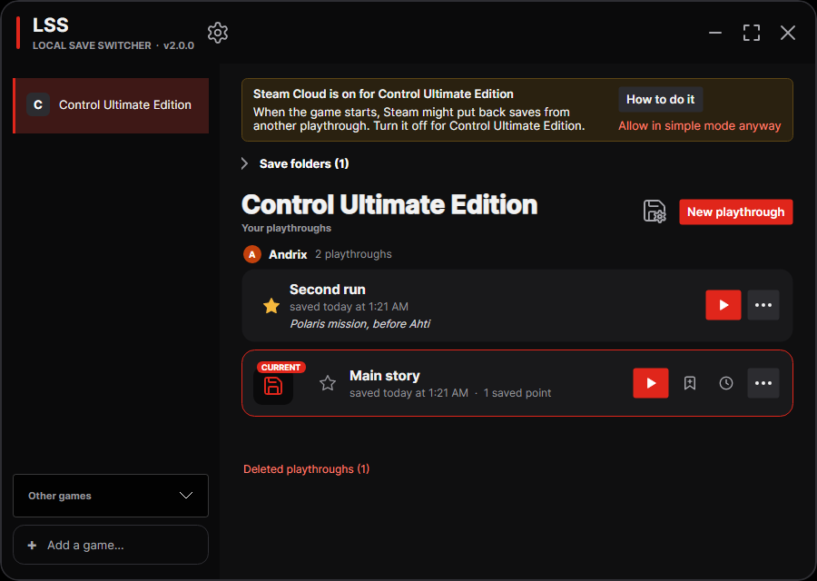
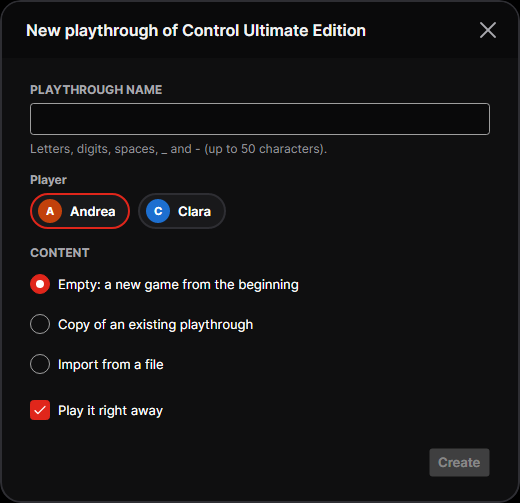
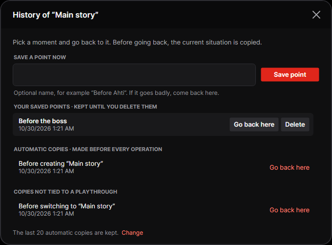
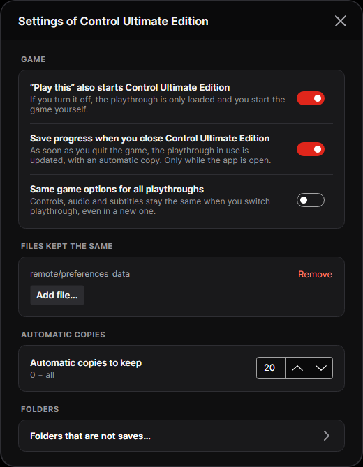

# LSS — Local Save Switcher

Multiple playthroughs for your PC games (Windows and Linux).

LSS keeps several playthroughs of the same game apart. Pick the one you want
to play and LSS loads its saves and starts the game. Before every switch it
makes a copy, and you can save points for the hard parts and go back to them
later.

Today LSS works with Steam: every Steam game that keeps its saves in Steam's
`userdata` folder. Other launchers, such as the Epic Games Launcher, are
planned. It runs on Windows 10/11 and on Linux, and the interface is in
English or Italian, following the system language.

## Which games work

LSS shows the games it finds in your Steam library. A game works when it has
saves in `userdata` (the folder `<Steam>/userdata/<account>/<AppID>`). Games
that have no saves yet are shown as *No saves yet: start the game once*. Games
that keep their saves somewhere else are listed under **Other games** with the
reason, and LSS doesn't manage them yet.

Some games save in `userdata` and also in another folder. LSS copies only the
`userdata` folder, so the other files are not switched with the playthrough.
If a game needs more files kept the same, see [Settings](#settings).

Games that were tested are listed in [docs/COMPATIBILITY.md](docs/COMPATIBILITY.md).

## Installation — Windows

1. Download `LSS-<version>-win-x64.zip` from the
   [releases page](https://github.com/Andrix64/Local-Save-Switcher/releases)
   and extract `LSS.exe` wherever you like.
2. Run it. Nothing to install: the program already contains everything it
   needs (that's why it's about 50 MB).

Requirements: Windows 10 or 11, 64-bit, and Steam installed.

> **The exe is not digitally signed.** Signing it needs a certificate that
> costs money every year, and LSS is a free hobby project. What this means:
>
> - **SmartScreen** may show "Windows protected your PC": choose
>   *More info → Run anyway*. It only asks the first time.
> - **Smart App Control** (Windows 11), if it's on, may refuse to start the
>   program, with no way to allow it for a single app. If that happens, the
>   only options are to turn Smart App Control off (Settings → Privacy &
>   security → Windows Security → App & browser control; it can't be turned
>   back on without reinstalling Windows) or to use LSS on another computer.
> - To check that the zip is the one built on GitHub, compare it with the
>   `.sha256` file next to it on the releases page.
>
> Every release is built by GitHub Actions from the code in this repository:
> anyone can see how.

## Installation — Linux

Linux x64 only. Steam can be installed natively, as Flatpak or as Snap: all
three are supported. Pick the file for your distribution from the
[releases page](https://github.com/Andrix64/Local-Save-Switcher/releases),
where `<version>` is the version in the file name, for example `1.0.0`.

| Distribution | File | Command |
|---|---|---|
| Ubuntu, Debian, Linux Mint | `lss_<version>_amd64.deb` | `sudo apt install ./lss_<version>_amd64.deb` |
| Fedora | `lss-<version>-1.x86_64.rpm` | `sudo dnf install ./lss-<version>-1.x86_64.rpm` |
| Steam Deck (desktop mode), openSUSE, Arch and others | `LSS-<version>-x86_64.AppImage` | `chmod +x LSS-<version>-x86_64.AppImage`, then run it |
| Any other distribution | `LSS-<version>-linux-x64.tar.gz` | extract it, then `./install.sh` (to remove it: `./install.sh --uninstall`) |

The AppImage needs no installation. The `.tar.gz` installs into `~/.local`
and doesn't need root.

## Before you start: turn off Steam Cloud

With Steam Cloud on, Steam may put back saves from another playthrough when
the game starts. Turn it off for the game: in Steam, open the **Library**,
right-click the game, choose **Properties**, and in **General** switch off
*Keep games saves in the Steam Cloud*. While it's on, LSS shows a yellow bar at
the top.

## How to use it

### Playthroughs

Each playthrough has its own saves. The one with the red border and
*IN THE GAME NOW* is the one loaded in the game.

- **Play this**: saves the progress of the current playthrough, loads the
  chosen one and starts the game through Steam. No questions asked: a copy is
  made before every switch.
- **Play**, on the playthrough already in the game: only starts the game.
- **⋯** on every playthrough: *Load without starting*, *Rename*, *Edit note*,
  *Export to a file...* and *Delete playthrough...*. If you load without
  starting, an **Undo** button appears at the bottom to go straight back to
  the previous playthrough.
- **New playthrough**: with the game's current saves, or empty to start again
  from the beginning.

  

- **Import...**: adds a playthrough exported on another computer.

Each card shows the note, the play time, when it was last saved and the saved
points.

### While you play

While the game is running LSS doesn't touch the saves and says so at the top.
When you close the game, your progress is saved automatically to the
playthrough you were playing and the play time is updated (LSS needs to be
open).

### History and saved points

**Save a point** (on the playthrough in the game) saves the current saves
under a name, for example before a boss: if it goes badly, you go back there.
**History** shows your saved points and the automatic copies made before
every operation; each row has **Go back here**. Before going back, the
current situation is copied, so you can always change your mind.

### Settings

- *“Play this” also starts the game*: if you turn it off, the playthrough is
  only loaded.
- *Save progress when you close the game*.
- *Same game options for all playthroughs*: controls, audio and subtitles stay
  the same when you switch playthrough.
- *Files kept the same*: other files of the game that you want to share
  between all playthroughs, for example a preferences file.
- How many automatic copies to keep (20 by default, 0 = all).

## Where the files are

Playthroughs, saved points, automatic copies and the operation log (`log.txt`)
are in one folder per account and game:

- Windows: `%LOCALAPPDATA%\LSS` (usually `C:\Users\<name>\AppData\Local\LSS`).
- Linux: `~/.local/share/LSS`.

OneDrive doesn't sync the Windows folder, so saves aren't locked,
half-downloaded or duplicated as "conflict copies". Settings has a button to
open the folder.

If more than one Steam account on the computer has saves for a game, LSS asks
which one to use at startup; each account has its own playthroughs.

To uninstall, delete the exe (or remove the package). To delete the data as
well, delete the folder above: that's where your playthroughs are.

## Coming from Control Save Manager

LSS is the new name of Control Save Manager. On first start, the data is moved
automatically from `%LOCALAPPDATA%\ControlSaveManager` to `%LOCALAPPDATA%\LSS`,
and the app tells you. Playthroughs exported with Control Save Manager can
still be imported.

## FAQ

**I loaded the wrong playthrough.** If the game didn't start, press **Undo**
in the notice at the bottom; otherwise play the previous one: its progress was
saved before the switch.

**I lost some progress.** Open **History**: there's a copy before every
operation, with date and description.

**I deleted a playthrough by mistake.** *Deleted playthroughs* appears at the
bottom of the main window: recover it from there, until the cleanup of
automatic copies removes it.

**Saves get mixed up between playthroughs.** It's almost always Steam Cloud:
make sure it's off (see above).

**My game isn't in the list.** Only games with saves in `userdata` are listed.
Look in **Other games** for the reason. To tell us about a game, use the
[game report](https://github.com/Andrix64/Local-Save-Switcher/issues/new/choose)
form.

**Something went wrong.** Open a bug report from the
[issues page](https://github.com/Andrix64/Local-Save-Switcher/issues/new/choose)
and attach the file `log.txt` from the data folder (see above).

## License

[MIT](LICENSE). What's new in each version: [CHANGELOG](CHANGELOG.md).
LSS collects no data: see [PRIVACY.md](PRIVACY.md). For developers:
[docs/DEVELOPMENT.md](docs/DEVELOPMENT.md).

*Steam is a trademark of Valve Corporation. LSS is not affiliated with or
endorsed by Valve. Game names are trademarks of their owners.*
